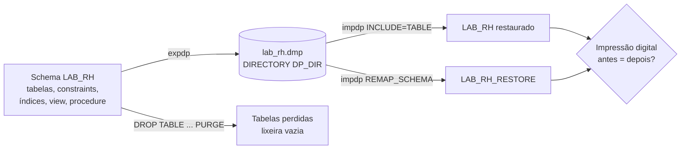
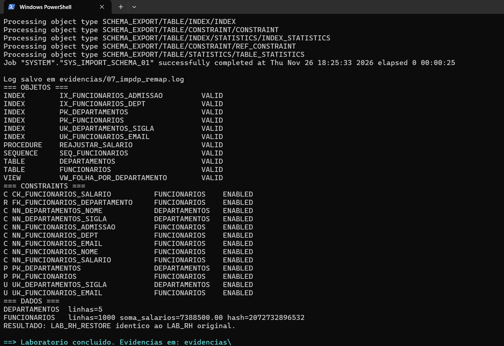

# Laboratório Oracle Data Pump: backup lógico e recuperação de desastre

Laboratório prático de **backup lógico com `expdp`** e **recuperação com `impdp`** no **Oracle Database 23ai Free**, rodando em Docker.

O cenário simula um erro humano comum em produção: tabelas removidas com `DROP TABLE ... PURGE`, sem passar pela lixeira e, portanto, sem a opção de `FLASHBACK TABLE ... TO BEFORE DROP`. A recuperação é feita a partir do dump do Data Pump e **validada automaticamente** com uma "impressão digital" do schema (objetos, constraints, contagens e hash dos dados) comparada antes e depois.

## O que este laboratório demonstra

- Criação de `DIRECTORY` e concessão de privilégios para o Data Pump
- Export em modo schema com arquivo de parâmetros (`parfile`)
- Simulação de desastre com `DROP TABLE ... PURGE` e confirmação de que a lixeira está vazia
- Import seletivo com `INCLUDE=TABLE`, trazendo de volta dados, constraints (PK, UK, FK, CHECK, NOT NULL), índices e estatísticas
- Recompilação de objetos dependentes (view e procedure) que ficaram `INVALID` após o drop
- Validação objetiva da restauração (comparação antes x depois, sem conferência "no olho")
- Bônus: restauração em outro schema com `REMAP_SCHEMA`, cenário típico de homologação ou de análise sem tocar no ambiente original

## Arquitetura



## Estrutura do projeto

```
oracle-datapump-lab/
├── docker-compose.yml          # Oracle Database 23ai Free (gvenzl/oracle-free)
├── sql/
│   ├── 01_setup.sql            # usuários LAB_RH e LAB_RH_RESTORE + DIRECTORY DP_DIR
│   ├── 02_create_schema.sql    # tabelas, constraints, índices, sequence, view, procedure e dados
│   ├── 03_validate.sql         # impressão digital do schema (objetos, constraints, contagens, hash)
│   └── 04_disaster.sql         # DROP TABLE ... PURGE + conferência da lixeira
├── parfiles/
│   ├── export_lab_rh.par       # expdp do schema LAB_RH
│   ├── import_tables.par       # impdp das tabelas (INCLUDE=TABLE)
│   └── import_remap.par        # impdp com REMAP_SCHEMA=LAB_RH:LAB_RH_RESTORE
├── scripts/
│   ├── lab.sh                  # automação para Linux, macOS, WSL e Git Bash
│   └── lab.ps1                 # automação para Windows PowerShell
└── evidencias/                 # saídas e logs gerados em cada execução
```

## Pré-requisitos

- Docker Desktop (ou Docker Engine) com o Compose
- Cerca de 4 GB livres em disco e 2 GB de RAM para o container
- Nenhuma porta livre é necessária: o banco é acessado por dentro do container

## Como executar

### Opção 1: tudo de uma vez

Windows (PowerShell, na pasta do projeto):

```powershell
Set-ExecutionPolicy -Scope Process -ExecutionPolicy Bypass
.\scripts\lab.ps1 all
```

Linux, macOS, WSL ou Git Bash:

```bash
chmod +x scripts/lab.sh
./scripts/lab.sh all
```

No primeiro uso, o download da imagem e a criação do banco levam alguns minutos.

### Opção 2: passo a passo (recomendado para estudar)

| Passo | Comando | O que acontece |
|---|---|---|
| 1 | `up` | Sobe o container, espera o banco ficar pronto e copia os scripts |
| 2 | `setup` | Cria os usuários, o `DIRECTORY` e o schema com 5 departamentos e 1.000 funcionários |
| 3 | `baseline` | Gera a impressão digital **antes** do desastre |
| 4 | `export` | Executa o `expdp` do schema `LAB_RH` |
| 5 | `disaster` | Remove as tabelas com `PURGE` e mostra que a lixeira está vazia |
| 6 | `import` | Restaura as tabelas com `impdp` |
| 7 | `verify` | Gera a impressão digital **depois** e compara com a de antes |
| 8 | `remap` | Bônus: importa o dump no schema `LAB_RH_RESTORE` |
| 9 | `down` | Remove o container e o volume |

Exemplo: `.\scripts\lab.ps1 export` ou `./scripts/lab.sh export`.

### Comandos executados nos bastidores

```bash
# Export (como LAB_RH)
expdp lab_rh/***@localhost:1521/FREEPDB1 parfile=export_lab_rh.par

# Import das tabelas perdidas (como LAB_RH)
impdp lab_rh/***@localhost:1521/FREEPDB1 parfile=import_tables.par

# Import em outro schema (como SYSTEM)
impdp system/***@localhost:1521/FREEPDB1 parfile=import_remap.par
```

## Como a restauração é validada

O script `03_validate.sql` gera um retrato do schema que não depende do nome do schema:

- lista de objetos e status (tabelas, índices, sequence, view, procedure)
- lista de constraints nomeadas e status
- contagem de linhas, soma dos salários e um hash (`ORA_HASH`) de todas as colunas de `FUNCIONARIOS`

Os arquivos `01_fingerprint_antes.txt` e `05_fingerprint_depois.txt` são comparados automaticamente. Se forem idênticos, a restauração recuperou dados, estrutura e código exatamente como estavam.

## Resultados

Execução completa (`lab.ps1 all`) em Windows com Docker Desktop, em novembro de 2026:

| Verificação | Resultado |
|---|---|
| Restauração do `LAB_RH` após o `DROP TABLE ... PURGE` | Idêntica ao estado original |
| Restauração em outro schema (`REMAP_SCHEMA` para `LAB_RH_RESTORE`) | Idêntica ao `LAB_RH` original |
| Objetos recuperados | 11 (2 tabelas, 6 índices, sequence, view e procedure), todos `VALID` |
| Constraints recuperadas | 13 (PK, UK, FK, CHECK e NOT NULL), todas `ENABLED` |
| Dados | 5 departamentos e 1.000 funcionários, soma dos salários 7.388.500,00 e mesmo hash antes e depois |
| Tempo do `impdp` com `REMAP_SCHEMA` | 25 segundos |

Validação final do schema restaurado com `REMAP_SCHEMA`:



## Boas práticas que este laboratório reforça

- **Backup só é backup depois de restaurado e validado.** Por isso a comparação automática faz parte do laboratório.
- **Data Pump é backup lógico, não substitui o RMAN.** Ele é ideal para recuperar objetos específicos, migrar schemas e criar cópias para homologação. Para recuperação física e point-in-time do banco inteiro, o caminho é RMAN.
- **Em produção, use `FLASHBACK_TIME` ou `FLASHBACK_SCN` no export** para garantir um dump consistente quando há transações em andamento.
- **`PURGE` elimina a rede de segurança da lixeira.** Sem ela, o tempo de recuperação depende de existir um backup recente e testado.
- **Arquivo de parâmetros (`parfile`)** deixa o procedimento repetível, versionável e fácil de revisar.
- **Logs do Data Pump são evidência.** Guarde-os junto com o dump para auditoria.

## Problemas comuns

| Sintoma | Causa provável | Solução |
|---|---|---|
| `port is already allocated` | Você descomentou `ports` com uma porta em uso | Use outra porta livre ou deixe `ports` comentado |
| Banco não fica `healthy` | Pouca memória para o Docker | Aumente a memória do Docker Desktop para 4 GB ou mais |
| `ORA-39002` / `ORA-39070` | Pasta de dumps sem permissão | Rode `up` de novo; ele recria `/opt/oracle/dumps` com o dono correto |
| Script `.ps1` bloqueado | Política de execução do Windows | `Set-ExecutionPolicy -Scope Process -ExecutionPolicy Bypass` |
| `lab.sh` com erro `\r` | Quebra de linha do Windows | `git config core.autocrlf false` e clone de novo, ou use o `lab.ps1` |

## Próximos passos

- Laboratório de backup e recuperação física com **RMAN** (full, incremental e point-in-time)
- Export com `PARALLEL` e `ESTIMATE_ONLY` em um banco com mais volume
- Migração de schema entre versões com Data Pump

## Ambiente

- Oracle Database 23ai Free (imagem [`gvenzl/oracle-free`](https://hub.docker.com/r/gvenzl/oracle-free))
- Docker / Docker Compose
- SQL\*Plus, Data Pump (`expdp`/`impdp`)

> As senhas deste projeto existem apenas para um laboratório local. Nunca use senhas fixas em scripts de produção.
